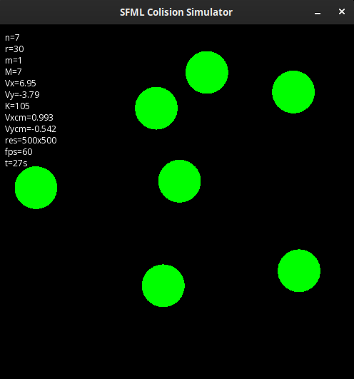

# SFML Colision Simulator

2D elastic colision simulator with SFML graphics library

<p align="center" width="100%">

</p>

## Install dependencies
### Debian packages
```sh
sudo apt install build-essential libsfml-dev pkgconf
```

## Build
```sh
make
```

## Run
```sh
make run
```

## License
[GPLv3](./LICENSE)

Copyright 2024-2026 Omar Zagonel El Laden
